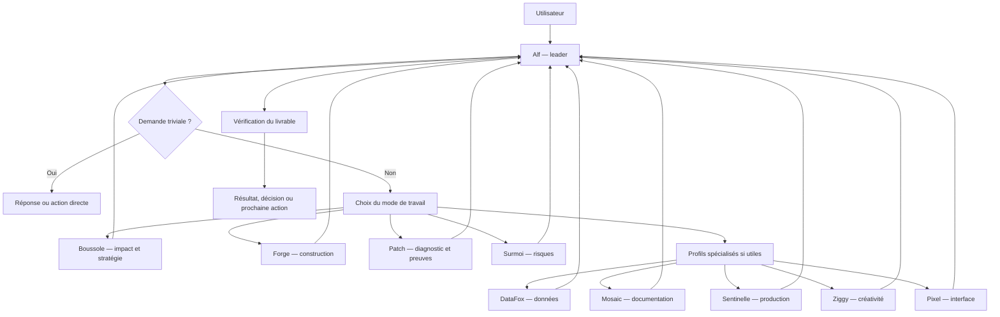

# Alf — agent IA autonome basé sur Hermes

> Un agent personnel capable de raisonner, d’utiliser des outils réels et de coordonner une petite équipe de spécialistes — sans transformer chaque demande en réunion interminable.

## Pourquoi ce dépôt ?

Ce dépôt présente **Alf**, mon agent IA personnel construit sur [Hermes Agent](https://github.com/NousResearch/hermes-agent).

Il ne s’agit ni d’un chatbot classique ni d’un nouveau framework : c’est une configuration concrète de Hermes combinant une personnalité, des outils, une mémoire persistante, des procédures réutilisables et plusieurs profils spécialisés.

L’objectif est simple : **produire un résultat réel, vérifié et proportionné à l’enjeu**.

Les profils présentés ci-dessous sont réellement configurés dans cette installation d’Alf. Ils possèdent des configurations et des sessions distinctes, mais ne doivent pas être confondus avec des conteneurs ou des frontières de sécurité fortes. Pour une tâche ponctuelle, Alf peut aussi lancer un sous-agent isolé de la conversation principale sans mobiliser un profil durable.

## Ce qu’Alf sait faire

Selon la demande et les autorisations accordées, Alf peut notamment :

- rechercher, comparer et citer des sources web ;
- lire, créer et modifier des fichiers ;
- exécuter du code et des commandes système ;
- travailler sur des dépôts Git et préparer des pull requests ;
- analyser des données et produire des documents ;
- automatiser des tâches récurrentes avec des planifications ;
- conserver des préférences et des faits utiles entre les sessions ;
- déléguer une partie complexe à un profil spécialisé ;
- vérifier le résultat obtenu avant de déclarer le travail terminé.

La présence d’un outil ne vaut pas autorisation permanente : le niveau de contrôle augmente avec le risque de l’action.

## Principe directeur

> **Alf orchestre. Forge construit. Patch prouve. Surmoi critique les risques réels. DataFox mesure. Mosaic mémorise. Sentinelle protège. Boussole évalue l’impact réel et le coût d’orchestration. Ziggy et Pixel enrichissent seulement quand nécessaire.**

Alf reste responsable de la décision finale. Les autres profils conseillent, produisent, vérifient ou alertent ; ils ne remplacent pas l’arbitrage du leader.

## Architecture générale

## Une équipe spécialisée, pas une foule d’agents

| Profil | Rôle | Question principale |
|---|---|---|
| **Alf** | Leader et orchestrateur | Quelle est la décision finale la plus utile ? |
| **Forge** | Développement et construction | Comment livrer simplement un artefact fonctionnel ? |
| **Patch** | Diagnostic et validation | Quelle hypothèse est prouvée par les tests ou les logs ? |
| **Surmoi** | Revue critique et sécurité | Existe-t-il un risque concret qui bloque l’action ? |
| **DataFox** | Données et mesure | Que montrent réellement les données ? |
| **Mosaic** | Documentation et mémoire | Quelle connaissance mérite d’être conservée ? |
| **Sentinelle** | Protection de la production | Le changement est-il réversible, observable et sûr ? |
| **Boussole** | Stratégie et impact | Le bénéfice justifie-t-il l’effort et l’orchestration ? |
| **Ziggy** | Exploration créative | Quelle piste non évidente mérite d’être examinée ? |
| **Pixel** | UX et interface | Le résultat est-il clair et utilisable ? |

Tous les profils ne sont pas activés à chaque demande. **L’orchestration elle-même a un coût** en temps, en calcul et en coordination.

## Les modes de travail

### Mode 0 — demande triviale

Alf répond ou agit seul. Une correction de typo n’a pas besoin d’un comité de pilotage intergalactique.

### Mode A — bug simple

**Patch → Forge → Alf**

Le problème est reproduit, une hypothèse est vérifiée, la correction minimale est implémentée puis testée.

### Mode B — incident sérieux ou production

**Patch → Sentinelle → Forge → Surmoi → Alf**

Le diagnostic précède la modification. La sécurité, la réversibilité, les journaux et le plan de retour arrière deviennent obligatoires.

### Mode C — nouvelle fonctionnalité

**Boussole → Ziggy → Pixel si interface → Forge → Patch → Surmoi → Mosaic → Alf**

La valeur est évaluée avant la construction. L’implémentation est ensuite testée, critiquée et documentée.

### Mode D — données, emploi ou portfolio

**DataFox → Boussole → Mosaic → Alf**, avec Forge si un artefact technique doit être construit.

Les faits et les critères de décision priment sur l’intuition.

### Mode E — réflexion complexe

Alf mobilise au maximum deux perspectives utiles parmi **Boussole, Surmoi, Ziggy et Mosaic**, sauf enjeu exceptionnel. Après deux cycles de critique au maximum, Alf arbitre.

## Cycle d’exécution

Une demande non triviale suit généralement ce chemin :

1. **Comprendre** le résultat attendu et les contraintes.
2. **Évaluer** le risque, les prérequis et le coût d’orchestration.
3. **Choisir** le minimum de profils et d’outils nécessaires.
4. **Agir** sur le système réel lorsque l’action est autorisée.
5. **Vérifier** avec des tests, logs, diffs, sources ou critères explicites.
6. **Corriger** si la preuve contredit l’hypothèse, avec deux cycles de critique maximum.
7. **Décider** : go, no-go, correction minimale, prochaine action ou clôture.
8. **Mémoriser** uniquement ce qui sera réellement utile plus tard.

Un plan n’est pas considéré comme un livrable lorsque la demande porte sur une réalisation. De même, une commande réussie ne prouve pas à elle seule que l’état final est correct : Alf relit ou reteste la cible lorsque c’est nécessaire.

## Mémoire et contexte

Alf distingue plusieurs niveaux d’information :

- **persona** : ton, identité et principes de fonctionnement ;
- **mémoire persistante** : préférences et faits stables ;
- **contexte thématique** : informations détaillées chargées seulement si elles sont pertinentes ;
- **historique de session** : éléments temporaires liés à une conversation ;
- **skills** : procédures réutilisables apprises au fil des tâches.

Cette séparation limite le bruit dans le contexte et évite de traiter une information ponctuelle comme une règle permanente.

La mémoire reste **bornée, révisable et potentiellement incomplète**. Une information importante doit toujours être confrontée à sa source actuelle avant de guider une décision à conséquences.

## Garde-fous

- **Sobriété** : pas de délégation si Alf peut répondre correctement seul.
- **Preuves** : tests, logs, diffs, sources ou critères de sortie plutôt que réussite supposée.
- **Moindre privilège** : les capacités disponibles ne sont utilisées que dans le périmètre autorisé.
- **Production protégée** : contrôles renforcés, sauvegarde et retour arrière avant toute action sensible.
- **Désaccord utile** : Surmoi bloque uniquement sur un risque précis ; sinon il indique qu’aucun risque bloquant n’est identifié.
- **Boucles bornées** : deux itérations de critique maximum avant arbitrage.
- **Confidentialité** : secrets, identifiants et données privées ne sont pas destinés aux livrables publics.
- **Décision humaine** : les opérations sensibles ou irréversibles conservent une porte de validation adaptée au risque.

## Exemples de demandes

- « Analyse ce bug, corrige-le et ouvre une pull request avec les preuves de test. »
- « Compare ces offres d’emploi avec mon profil et classe-les selon des critères explicites. »
- « Transforme ces notes en document structuré sans perdre les décisions ni les responsables. »
- « Surveille cette source chaque semaine et alerte-moi uniquement en cas de changement utile. »
- « Vérifie l’état d’un service, diagnostique l’incident et propose la correction minimale réversible. »

## Socle technique

Alf s’appuie sur les capacités de Hermes Agent :

- modèles et fournisseurs interchangeables ;
- outils de terminal, fichiers, web, navigateur, vision et génération de documents ;
- skills chargeables à la demande ;
- mémoire persistante et recherche dans l’historique ;
- profils indépendants et délégation de sous-tâches ;
- exécution planifiée et intégrations de messagerie ;
- contrôle des actions, vérification et reprise sur erreur.

La disponibilité exacte de chaque capacité dépend de la configuration, des identifiants installés et des permissions accordées.

Les profils séparent notamment leurs configurations, sessions, mémoires et skills. Cette séparation facilite la spécialisation ; elle ne constitue pas, à elle seule, une sandbox de sécurité.

## Limites

- Un modèle peut produire une réponse erronée, incomplète ou devenue obsolète.
- Une revue contradictoire améliore la robustesse, mais ne prouve pas qu’une conclusion est vraie.
- Un outil ou un service externe peut être indisponible, refuser une action ou retourner un résultat partiel.
- La mémoire ne remplace ni une source faisant autorité ni la vérification de l’état réel.
- Les décisions importantes restent soumises à une validation humaine adaptée à leurs conséquences.
- Les contrôles décrits réduisent le risque ; ils ne garantissent ni l’absence d’erreur ni une sécurité absolue.

## Ce que ce dépôt n’est pas

- une distribution officielle de Hermes Agent ;
- une promesse d’autonomie sans contrôle ;
- un export de configuration prêt à déployer ;
- un dépôt contenant des secrets ou l’infrastructure privée de l’agent.

Il documente une **façon de concevoir et d’exploiter un agent personnel** : autonome sur les tâches réversibles, prudent sur les changements sensibles et exigeant sur les preuves.

## Projet en évolution

Alf évolue avec les usages : nouveaux skills, meilleurs contrôles, mémoire mieux structurée et orchestration plus sobre. Les changements importants passent par une branche de développement puis une pull request avant intégration.

---

Construit avec [Hermes Agent](https://github.com/NousResearch/hermes-agent), une quantité raisonnable de prudence et juste assez d’humour venu de Melmac.
